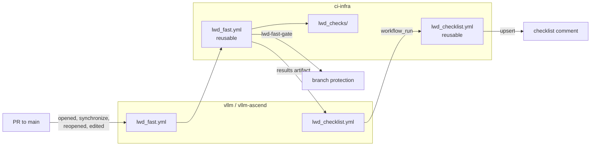

# LWD CI

CI for the `vllm-data-comm` forks of vLLM (`vllm`, `vllm-ascend`). Shared checks and workflows live in this repository; each product repository holds thin caller workflows.

## Background

- Every workflow inherited from upstream is gated on `github.repository_owner == 'vllm-project'`, so none has ever run in `vllm-data-comm/vllm`.
- Several `vllm-ascend` workflows lack that gate and request runner labels that do not exist in this org. They end in `startup_failure`, or wait 18-24 hours and are cancelled.
- The org has no self-hosted runners. All repositories are public, so GitHub-hosted runners are free.
- `main` branch protection requires no status checks, so nothing automated blocks a merge.
- Merged and open PRs already show problems a machine could catch: commits without `Signed-off-by` (#7, #10), a PR title in commit style (#10), and non-upstream commits from other branches mixed into a feature PR (#12).

## Scope

This round:

- `vllm` and `vllm-ascend`: disable inherited workflows, add the fast lane, the checklist comment, and required checks.

Not this round:

- Unit tests, system tests and mypy in either repository ([ci-infra#4](https://github.com/vllm-data-comm/ci-infra/issues/4)). This round builds the framework. `main` has not finished migrating from the `mm` branch, so its LWD tests do not yet describe the code. A slow lane is added once they do; the lane model below already allows it.
- P3: NPU system tests and nightly runs on self-hosted NPU runners. Machines exist; deferred.
- P4: an AI review of the PR template checklist. It will append a section to the same checklist comment.
- Any `--all-files` lint, and any policy on merge commits (the branch model is not settled).

## Check model

Every check has two independent attributes.

| Attribute | Values | Decides |
| --- | --- | --- |
| Lane | fast (slow: deferred) | When the result arrives. Fast: under ~2 min, reruns on every PR update including title and body edits. A future slow lane has no time limit and reruns only when code is pushed. |
| Gating | required / advisory | Whether the result blocks merging. Advisory results only appear in the checklist comment. |

A new check starts as advisory and is promoted to required once it has proven free of false positives. Both attributes are set in one place, `lwd_checks/catalog.py`, so a change applies to both repositories at once.

### Catalog

| ID | Check | Lane | Gating | Repos |
| --- | --- | --- | --- | --- |
| `pr-title` | PR title format | fast | required | both |
| `commits` | Commit subject format and DCO signoff | fast | required | both |
| `pre-commit` | pre-commit hooks on the PR's own files | fast | required | both |
| `param-count` | Functions with more than 5 parameters | fast | advisory | both |
| `function-length` | Functions longer than 100 lines | fast | advisory | both |
| `class-prefix` | New classes not prefixed `Lwd` | fast | advisory | both |
| `new-file-path` | New files outside an `lwd` path | fast | advisory | both |
| `patch-usage` | Monkey patching, or changes under `vllm_ascend/patch/` | fast | advisory | both |
| `rfc-link` | Over 500 added lines without an RFC issue | fast | advisory | both |
| `bugfix-tests` | `[Bugfix]` PR that changes no tests | fast | advisory | both |

## Architecture



```text
ci-infra/
├── .github/workflows/
│   ├── lwd_fast.yml         reusable: fast lane jobs and lwd-fast-gate
│   ├── lwd_checklist.yml    reusable: render and upsert the checklist comment
│   ├── lwd_image.yml        reusable: nightly image build and push (see lwd_image.md)
│   └── test.yml             ci-infra's own CI: pytest and actionlint
├── docker/
│   └── Dockerfile.lwd       layered LWD image, on the official vllm-ascend image
├── lwd_checks/              check scripts and catalog, Python standard library only
├── scripts/
│   └── disable_inherited_workflows.sh
└── tests/

vllm/.github/workflows/
├── lwd_fast.yml             calls ci-infra lwd_fast.yml@main
├── lwd_checklist.yml        on workflow_run of the fast lane; calls ci-infra lwd_checklist.yml@main
└── lwd_image.yml            nightly + dispatch; calls ci-infra lwd_image.yml@main
```

`vllm-ascend` carries the fast lane and the relay only.

Decisions:

- **Callers reference `@main`, not a tag.** Pinning would turn every rule change into two extra bump PRs. In exchange, a change merged into ci-infra takes effect in both repositories immediately. Reusable workflows check out ci-infra at `main` to match.
- **ci-infra requires a PR but no approval, for now.** It has one main maintainer, who cannot approve their own PRs. Its own `test.yml` becomes a required check instead. Revisit when a second maintainer joins.
- **Inherited workflows are disabled, not deleted.** `scripts/disable_inherited_workflows.sh <repo>` disables every workflow whose file name does not start with `lwd_`. Deleting or editing the upstream files would conflict on every upstream merge. Disabled is a repository setting and survives merges, but new upstream workflows arrive enabled, so the script reruns after each upstream sync.
- **The relay workflow lives in each product repository.** `workflow_run` only listens to workflows in the same repository. The caller is a few lines; the logic is in ci-infra.
- **Runners are `ubuntu-latest`.** Third-party actions are pinned by commit SHA, as upstream does.

## Workflows

### Fast lane

Trigger: `pull_request` targeting `main`, types `opened`, `synchronize`, `reopened`, `edited`. `edited` covers title and body changes, which `pr-title`, `rfc-link` and `bugfix-tests` read. Concurrency cancels the previous run of the same PR.

Jobs: `pr-title`, `commits`, `pre-commit`, `standards` (runs every advisory rule), then `lwd-fast-gate`. No job is ever skipped. A skipped required check counts as passing in GitHub and would hide an earlier failure.

The whole lane reruns on a title edit, including pre-commit. That costs a minute or two and keeps the gate's result complete.

### Results and gates

Every check job writes a results file and uploads it as its own artifact, `lwd-results-<lane>-<job>`:

```json
{
  "schema": 1,
  "lane": "fast",
  "pr": 123,
  "head_sha": "0123abc...",
  "checks": [
    {
      "id": "param-count",
      "status": "fail",
      "summary": "1 function over 5 parameters",
      "findings": [
        {"path": "vllm/v1/lwd_control/x.py", "line": 42, "message": "`build` has 7 parameters"}
      ]
    }
  ]
}
```

`status` is `pass`, `fail` or `error`. A job's exit code follows the catalog: a required check fails its job when the check fails, so the red job links straight to the log. An advisory job only fails when the script itself crashes.

The gate job needs every job in its lane with `if: always()`. It fails if any required check is not `pass`, including a missing result. It ignores advisory checks.

### Checklist relay

`lwd_checklist.yml` runs on `workflow_run` (`completed`) of a lane. Fork PRs get a read-only token, so the lanes cannot comment themselves; the relay runs in the base repository with `pull-requests: write` and `actions: read`.

1. Find the open PR into this repository whose head is the run's head repository and branch — trusted `workflow_run` fields — and continue only if its current head SHA equals `workflow_run.head_sha`. (`/commits/{sha}/pulls` cannot see fork PRs, so the head filter is used.) This drops stale runs.
2. For that head SHA, fetch the latest run of each lane and its result artifacts, and validate them against the schema.
3. Rebuild the whole comment from every lane and upsert it.

Rebuilding from every lane each time makes the relay order-independent. GitHub concurrency keeps only one pending run and cancels older pending ones; a cancelled relay loses nothing, because the next one renders the full state. Concurrency is keyed on the head repository and branch, because `workflow_run` payloads do not carry the PR number for fork PRs.

`workflow_run` only fires for workflow files on the default branch, so the comment starts working after the caller files merge into `main`.

## Check rules

### What counts as the PR's own changes

Sync PRs merge upstream `main`. Checking every upstream file in them would bury the PR in noise. The checks therefore scope themselves to the PR's own changes:

- `base` = merge base of the PR's base SHA and head SHA.
- Own commits = `git rev-list --no-merges <base>..<head> --not upstream/main`. `upstream/main` is fetched with `--filter=tree:0`: commit graph only, no file contents. The upstream repository is an input: `vllm-project/vllm` or `vllm-project/vllm-ascend`.
- Own files = files touched by own commits that still exist at head.

A pure sync PR has no own commits, so only `pr-title` has anything to check. Conflict resolutions inside its merge commit are not checked; this is accepted. A non-upstream commit that sneaks in, as in #12, is an own commit and gets checked.

### Required checks

**`pr-title`.** The first tag is a type tag from AGENTS.md; `[Lwd]` appears among the tags; one or more spaces and a description follow.

```text
^\[(Bugfix|Feature|Perf|Refactor|CI|CI/Build|Test|Doc|Docs|Misc)\](\[[^][]+\])* +\S
```

**`commits`.** Every own commit must:

- have a subject matching `^(feat|fix|perf|refactor|docs|test|ci|chore)\(lwd\): \S`;
- have a subject with no CJK characters or full-width punctuation;
- carry a `Signed-off-by:` trailer whose email equals the author email, case-insensitive (the DCO rule).

The failure output lists each offending commit with its reason and a fix command, for example `git rebase --signoff <base>`.

**`pre-commit`.** `pre-commit run --files <own files> --show-diff-on-failure` at the default stage, so CI runs the same hooks as a local commit. The `pre_commit_skip` input skips hooks: `vllm` skips `mypy-3.10`, because mypy is not part of this round. The hook cache is keyed on the hash of `.pre-commit-config.yaml`. `vllm-ascend`'s `check-long-functions` hook inspects the staged diff, which is empty in CI, so it always passes there; `function-length` covers that rule.

### Advisory checks

They only flag problems the PR introduces. Upstream code has many functions over 100 lines; flagging existing code would flag every PR. Python checks parse base and head versions of each own file with `ast`, follow renames with `git diff -M`, and match functions and classes by qualified name (`Class.method`). Source roots are an input: `vllm/` or `vllm_ascend/`, excluding `tests/`.

| ID | Flags |
| --- | --- |
| `param-count` | A function whose parameter count exceeds 5 at head, and that is new or was at most 5 at base. Leading `self` / `cls` is not counted; `*args` and `**kwargs` count as one each. |
| `function-length` | A function longer than 100 lines at head, new or at most 100 at base. Lines run from the `def` line to the last line; decorators are excluded. |
| `class-prefix` | A class new at head whose name starts with neither `Lwd` nor `_Lwd`. |
| `new-file-path` | An added or renamed-into file, anywhere in the repository, with no path component containing `lwd` (case-insensitive). |
| `patch-usage` | Any own file under `vllm_ascend/patch/`; or, in source roots, new occurrences of assignment to an attribute of an imported name (`module.attr = ...`, `SomeClass.method = ...`), `setattr(<imported name>, ...)`, or `mock.patch`. |
| `rfc-link` | More than 500 added lines in own `*.py` files outside `tests/`, with no issue titled `[RFC]...` referenced in the PR body (`#N` in this repository, or a `vllm-data-comm` issue URL). The finding also notes whether the PR touches `docs/`. |
| `bugfix-tests` | A PR whose type tag is `[Bugfix]` and whose own files include nothing under `tests/`. |

The 500-line rule counts `.py` outside `tests/` as an approximation of "excluding kernels, data, config and tests". It also counts config parsing code, which is one reason the check is advisory.

## Checklist comment

One comment per PR, created by the relay and updated in place. It is posted even when everything passes, so a missing comment never reads as "checks did not run".

```markdown
<!-- lwd-ci-checklist -->
### LWD CI checklist

**Fast lane** · `0123abc`

- [x] PR title (required)
- [ ] Commits (required)
  - `4f5e6d7`: missing `Signed-off-by` matching the author email
- [x] pre-commit (required)
- [ ] Parameter count (advisory)
  - `vllm/v1/lwd_control/x.py:42` `build` has 7 parameters
- [x] Function length (advisory)
- [x] Class prefix (advisory)
- [x] New file path (advisory)
- [x] Patch usage (advisory)
- [x] RFC link (advisory)
- [x] Bugfix tests (advisory)
```

- Checkboxes are display only. Every update rewrites the comment, so manual ticks are lost. A committer accepts advisory findings by approving the PR.
- A lane still running shows as pending. A check with no result shows as "did not run".
- Advisory checks only earn their keep if someone reads them: the list stays short because it only contains problems the PR introduces, and committers read it during review.

## Security

- Lanes use `pull_request`, never `pull_request_target`. Fork code runs with a read-only token and no secrets.
- The relay runs base-repository code with a write token. It never checks out or executes PR code. It parses the artifact as data against the schema, and finds the PR through the trusted `workflow_run` head fields. Artifact downloads stop at the redirect and fetch the signed URL without the token.
- Rendered findings are escaped: backticks, `|`, HTML, and `@` (no pings). Each finding and the whole comment are length-capped below GitHub's 65,536-character limit.
- A PR can edit the caller workflows to skip checks. CODEOWNERS covers this in `vllm` and `vllm-ascend`: every file, `.github/` included, needs committer review.
- ci-infra requires no approval, so a ci-infra change reaches both repositories' gates without a second reviewer. Its `test.yml` is the remaining gate.
- Forks of first-time contributors need a committer's approval before workflows run (the repository default, kept).

## Image builds

Nightly images are built by the same layering: a thin `lwd_image.yml` caller in `vllm` (schedule plus dispatch) calls the reusable builder here, which layers the two forks' sources on a pinned official vllm-ascend image and pushes to `ghcr.io/vllm-data-comm/lwd`. It is a deployment artifact, not a check, so it stays outside the lane model. Design and runbook: [`lwd_image.md`](lwd_image.md).

## Rollout

1. ci-infra PR: catalog, checks, reusable workflows, tests, `test.yml`.
2. One PR each in `vllm` and `vllm-ascend` adding the caller workflows. These PRs exercise the fast lane on themselves; the checklist starts after merge.
3. Run `scripts/disable_inherited_workflows.sh` against both repositories.
4. Watch one or two real PRs, read the exact check context names (`<caller job> / <gate job>`), then require them on `main`:
   - `vllm` and `vllm-ascend`: `lwd-fast-gate`;
   - `ci-infra`: its `test.yml` job.

   Required status checks differ per repository by design. Review rules (approvals, code owners, stale dismissal, admin enforcement) stay identical across `vllm` and `vllm-ascend`; ci-infra requires a PR without approval.
5. Open PRs pick up the workflows on their next push: `pull_request` runs the workflow files from the merge ref, which includes `main`.
6. Add a short pointer outside the team standards zone of both `AGENTS.md` files: CI lives in ci-infra, and here is how to run the checks locally (`uv run --python 3.12 --no-project python -m lwd_checks ...` from a ci-infra clone).
7. After every upstream sync, rerun step 3's disable script.

## To verify on the first runs

- `vllm-ascend` hooks that call scripts (`gitleaks-offline-scan`, `tools/shellcheck.sh`) may need tools the runner lacks.
- Fast lane duration against the ~2 min target. The first lever is the pre-commit cache.
- The exact check context names for branch protection.
