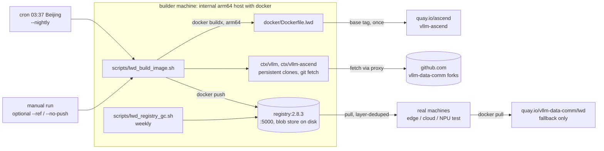

# LWD Internal Image Pipeline

The LWD nightly images, built on an internal machine and served from an
internal registry, replacing ghcr.io/quay.io as the pull source for the
real machines. Companion of [lwd_image.md](lwd_image.md) (the GitHub
Actions pipeline it derives from; same Dockerfile, same semantics).

## Background

The GitHub-hosted build itself is fine — free arm64 runners, ~15 min,
stable upstream access. The pain is the consumer side: measured from the
real-machine network, quay.io serves ~3.4 MB/s and ghcr.io ~0.7 MB/s,
and both are the flakiest external hosts we touch (evidence: 2026-10
bandwidth probes recorded in lwd_image.md). A full base image is ~7 GB;
every fresh machine and every base-tag bump pays for it over that link.

Moving build + distribution inside the intranet removes ghcr/quay from
the hot path entirely. What remains external is small and works fine
from the intranet: the three git repositories, PyPI, crates.io and
rustup. The base image is pulled from quay exactly once per tag per
machine-generation (the registry then carries its blobs), and tag bumps
are rare by policy (see lwd_image.md's base-tag rules).

## Architecture



Decisions:

- **The builder is a plain internal arm64 machine, not a GitHub
  self-hosted runner.** The build never touches an NPU (proven nightly
  by the NPU-less GitHub arm runners), so any arm64 docker host works —
  including one of the NPU test machines, which is the current plan.
  A self-hosted runner would keep a permanent outbound connection to
  github.com alive, which is exactly the network dependency this move
  is meant to remove.
- **The registry is a stock `registry:2.8.3` container**, no Harbor, no
  SWR. All machines pull `<builder>:5000/lwd:...`; blobs are
  content-addressed, so the base image is stored once and shared across
  every tag and both SoC variants. ghcr/quay keep existing as the
  fallback/public channel, untouched by this pipeline.
- **Plain HTTP on the intranet, optional htpasswd.** Consumers add one
  `insecure-registries` entry to `daemon.json`. TLS needs a CA
  distributed to every machine; revisit only if the security policy
  demands it (upgrade path below).
- **The canonical registry name is the consumer-visible name.** The
  registry keys repositories by the name used at push time — pushing as
  `127.0.0.1:5000/lwd` would create a separate repository from
  `<builder-host>:5000/lwd`. `REGISTRY` in the conf file is one value,
  used identically by builder and consumers.
- **Tag scheme and build semantics are identical to the GitHub
  pipeline** (`sha-<short>[-a3]`, `nightly-YYYYMMDD[-a3]`,
  `nightly[-a3]`), so runbooks and habits transfer unchanged. The
  soc→base-tag mapping now lives in three places (Dockerfile `BASE_TAG`
  default, workflow resolve step, `variant_base_tag()` in the build
  script); the script cross-checks the Dockerfile and warns on drift,
  and all three move in the same PR when the pin changes (lwd_image.md).
- **Retention is journal-based, not manifest-date-based.** The script
  appends `<epoch> <soc> <shas> <digest>` to
  `$WORK_DIR/state/journal.log` after every push and prunes journaled
  digests older than `KEEP_DAYS`. Deleting a registry manifest removes
  *all* its tags at once (there is no tag-level delete in the v2 API),
  which is precisely the semantics we want: a pruned nightly takes its
  `sha-` tag with it, and the rolling `nightly` digest is always
  protected — even when it is old, because someone pinned it back.

## Resource budget (builder machine)

| Item | Size | Notes |
| --- | --- | --- |
| base image, per SoC variant | ~7 GB each | measured on the GitHub runners (lwd_image.md) |
| local docker images, both variants | ~16 GB | builder keeps its own `nightly` for local tests |
| registry blob store | ~16 GB + ~0.5–1 GB per kept nightly | blobs deduplicate across tags and variants |
| build caches (buildx, sources) | a few GB | `$WORK_DIR` and docker data root both on the big disk |

The script refuses to start (`--min-free-gb`, default 40) when either
the work dir or the docker data root drops below the threshold. Verify
the real numbers after the first build with `docker images`,
`du -sh $LWD_REGISTRY_DATA` and `df -h`.

Build duration per variant on the 4-core GitHub arm runner was
30 min – 1.5 h (vllm editable install + Rust frontend dominate); expect
the same order on the builder. Schedule accordingly (below), and note a
build is CPU/IO-heavy — do not overlap it with perf-sensitive nightly
test runs on the same machine.

## Deployment manual

### Builder (one machine, once)

```bash
# 1. Prereqs: docker (with the buildx plugin, compose v2), git, curl,
#    flock (util-linux), GNU date — stock on any Linux server.
#    The intranet proxy must allow github.com, pypi.org,
#    static.rust-lang.org, crates.io, quay.io and docker.io.
git clone https://github.com/vllm-data-comm/ci-infra.git /path/to/ci-infra
cd /path/to/ci-infra
git checkout <this branch or main once merged>

# 2. Site config.
cp scripts/lwd_image_builder.conf.example scripts/lwd_image_builder.conf
#    edit: REGISTRY=<builder-host>:5000 (the name consumers will use),
#    WORK_DIR / LWD_REGISTRY_DATA on the big disk.

# 3. Registry up (plain HTTP by default).
set -a; . scripts/lwd_image_builder.conf; set +a
docker compose -f docker/registry/docker-compose.yml up -d
curl -fsS "http://$REGISTRY/v2/"   # -> {} (empty json, service healthy)

# 4. Optional: enable htpasswd auth (uncomment the three environment
#    lines and the /auth mount in docker/registry/docker-compose.yml):
#    mkdir -p docker/registry/auth
#    docker run --rm httpd:2 htpasswd -nbB lwd <password> \
#        > docker/registry/auth/htpasswd
#    ... then set REGISTRY_USER/REGISTRY_PASSWORD in the conf and
#    `docker login $REGISTRY` on every consumer.

# 5. First build. Pulls the ~7 GB base image from quay (slow, one time
#    per variant; or `docker load` a copy from a machine that has it).
#    --no-push first if you want a dry run that cannot touch anything.
scripts/lwd_build_image.sh --soc a2 --nightly
#    smoke test what the machines will get:
docker pull $REGISTRY/lwd:nightly && \
docker run --rm $REGISTRY/lwd:nightly \
    python3 -c "import torch, torch_npu, vllm, vllm_ascend; print('ok')"
```

Note: `docker pull` on the builder itself pulls through the registry
like any other machine — that is on purpose, so the builder tests
exactly what it serves.

### Crontab (builder)

```cron
# nightly build of both variants, 03:37 Beijing; self-update first so
# the cron always runs the merged script (dedicated clone — reset is
# destructive to local edits by design)
37 19 * * * cd /path/to/ci-infra && git fetch origin main --quiet && git reset --hard origin/main --quiet && scripts/lwd_build_image.sh --nightly >> /data/lwd-image-builder/logs/cron.log 2>&1
# registry garbage collection, weekly, outside the build window
20 4 * * 0 cd /path/to/ci-infra && scripts/lwd_registry_gc.sh >> /data/lwd-image-builder/logs/cron.log 2>&1
```

### Consumers (each real machine, once)

```bash
# 1. Trust the plain-HTTP intranet registry (one line, then restart).
sudo tee /etc/docker/daemon.json <<'EOF'
{"insecure-registries": ["<builder-host>:5000"]}
EOF
sudo systemctl restart docker
# (merge the key into the existing daemon.json if there is one)

# 2. Pull. Machines that already have the official base image from quay
#    keep their layer cache; docker deduplicates layers by digest across
#    registries, so only the new overlay layers transfer.
docker pull <builder-host>:5000/lwd:nightly        # a2
docker pull <builder-host>:5000/lwd:nightly-a3     # a3
```

There is no consumer-side cron: bring-up pulls on demand (or a morning
cron if a machine must be warm at 9am), via the same `docker pull`.

## Runbook

- **Build an image for a branch under review** (replaces the old
  workflow_dispatch flow, which is also currently broken by a platform
  issue):
  `scripts/lwd_build_image.sh --soc a2 --vllm-ref feat/xxx --no-push`
  then `docker run lwd:sha-<sha>...` on the builder; or with push (no
  `--nightly`) to let other machines pull the `sha-` tag.
- **Base-tag bump** (rare, per lwd_image.md rules): change
  `variant_base_tag()` here, the workflow's resolve step and the
  Dockerfile `ARG BASE_TAG` in one ci-infra PR; the script warns on
  Dockerfile drift at every run. The first build after a bump pulls the
  new ~7 GB base over the slow quay link — start it manually, not via
  cron, so the failure mode is visible.
- **Builder dies / move to another machine**: any arm64 docker host.
  Clone ci-infra, copy the conf file, `docker compose up -d` the
  registry pointing `LWD_REGISTRY_DATA` at the rescued disk (or start an
  empty registry; consumers re-pull from quay once if the blobs are
  gone). Install the crontab. Done — the builder is stateless beyond
  the conf, the clones (re-fetched) and the journal (retention then
  keeps everything until the journal refills).
- **Registry running out of disk**: run `scripts/lwd_registry_gc.sh`
  manually; if still tight, lower `KEEP_DAYS`. Unreferenced-but-kept
  blobs shrink at GC, not at manifest deletion.
- **Is last night's build good?** `curl http://<builder>:5000/v2/lwd/tags/list`
  (a `nightly-YYYYMMDD` for today must exist) and
  `$WORK_DIR/logs/build-*.log` on the builder. A missing tag is the
  fail-fast signature of a failed cron run — check the log before
  debugging the machines.

## Relationship to the GitHub pipeline

- The GitHub workflow (`lwd_image.yml` here + caller in the `vllm` fork)
  keeps running unchanged for now: it is the fallback channel and the
  publisher of the public quay copy. Once the internal nightly has been
  green for a stretch, drop the `schedule:` trigger from the `vllm`
  fork's caller (keep `workflow_dispatch`) and resolve the
  leaked-quay-token cleanup noted in the old design doc.
- Known duplication, deliberate: the soc→base-tag mapping and the tag
  scheme exist in both the workflow and the build script. Unifying them
  (workflow calls this script) is deferred until the internal pipeline
  is proven, to avoid destabilizing the working fallback.
- Not planned: mirroring the internal registry back to ghcr/quay
  automatically. Publish-on-demand by `docker tag` + `docker push` when
  an external copy is needed.

## Open items

- BuildKit cache mounts for pip/cargo inside Dockerfile.lwd would cut
  rebuild time on the builder (the sources change nightly, dependencies
  do not). Deferred: it modifies the shared Dockerfile, do it once the
  internal build is the primary path, with a nightly to verify.
- TLS upgrade path (if required): put a cert + key under
  `docker/registry/`, mount them, set `REGISTRY_HTTP_TLS_*`, drop the
  `insecure-registries` entries. Mechanical, not designed here.
- The base image pull from quay remains the one slow external step
  (once per tag bump). If that ever hurts, a pull-through cache config
  on the registry container solves it; not worth the second moving part
  today.
